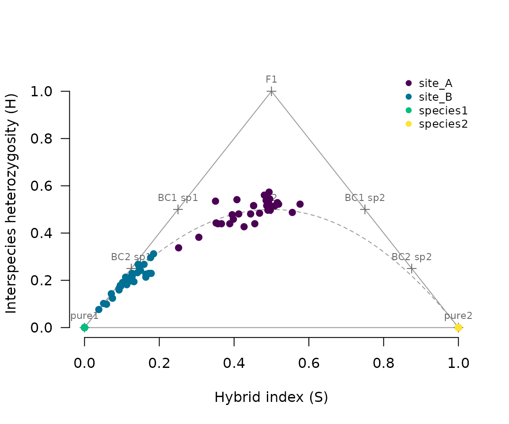

# Getting started with hybridclock

This vignette walks through a small example: two pure reference groups
and two hybrid sites, simulated so that the true histories are known.

``` r

library(hybridclock)
ex <- hybridclock_example()
table(ex$groups)
#> 
#>   site_A   site_B species1 species2 
#>       30       30       20       20
ex$truth
#>      site generation hybrid_age_both hybrid_age_rare backcrosses arrival_rate
#> 4  site_A          4        3.641667        3.754127   0.5416667            0
#> 15 site_B         15        9.592318       14.787010   2.7037638            0
```

## Markers and hybrid scores

Diagnostic markers are SNPs nearly fixed for different alleles in the
two reference groups. With `locus`, one SNP per locus is kept so markers
are effectively unlinked. Shared loci, common in both species, are used
later to measure inbreeding.

``` r

mk <- diagnostic_markers(ex$genotypes, ex$groups, "species1", "species2", locus = ex$locus)
sh <- shared_loci(ex$genotypes, ex$groups, "species1", "species2", locus = ex$locus)
c(diagnostic = nrow(mk), shared = nrow(sh))
#> diagnostic     shared 
#>        314        106
sc <- hybrid_scores(ex$genotypes, mk)
plot_triangle(sc, ex$groups)
```



Site A sits around the F2 position, as expected for a young hybrid
swarm. Site B hugs the lower left edge: its hybrids have backcrossed
repeatedly into species 1.

## Recent hybrids, one animal at a time

``` r

cl <- classify_hybrids(sc)
table(ex$groups, cl$class)
#>           
#>            BC2_species1 F2 later pure1 pure2
#>   site_A              0 17    13     0     0
#>   site_B              3  0    27     0     0
#>   species1            0  0     0    20     0
#>   species2            0  0     0     0    20
```

Animals that fit none of the early classes are called `later`. Their
ages are a population question.

## Population histories

A reference set of simulated histories is matched to the data: the same
number of markers and shared loci, the same sample size, and ranges of
settings that are plausible for the study system. Real analyses should
use thousands of histories (`n_sims = 4000` or more) and 50 generations;
this example is kept small so it runs quickly.

``` r

ref <- build_reference(n_sims = 300, generations = 20, breeders = c(20, 150),
                       n_markers = nrow(mk), shared_freq = sh$freq, sample_size = 20)
clock <- train_clock(ref, committees = 5)
clock
#> hybridclock model: hybrid_age_both, hybrid_age_rare, backcrosses, arriving, arrival_rate 
#>   reference: 314 markers, 106 shared loci, samples of 20 animals, breeders 20 to 150 
#>   90% intervals; accuracy on held-out runs:
#>           target typical_error coverage
#>     arrival_rate         0.723     0.85
#>         arriving            NA     0.73
#>      backcrosses         0.092     0.89
#>  hybrid_age_both         0.177     0.89
#>  hybrid_age_rare         0.172     0.89
#>   (for arriving, coverage is the share called correctly at p > 0.5)
#>   individual classes are used when at least 95% of hybrids fit an early class
#>   samples made up mostly (80% or more) of F1s are dated by their classes
```

The printed accuracy comes from simulated runs that were not used to fit
or calibrate the models. Now the two sites:

``` r

hyb <- ex$groups %in% c("site_A", "site_B")
est <- estimate_history(clock, sc[hyb, ], ex$groups[hyb],
                        diag = orient_genotypes(ex$genotypes, mk)[hyb, ],
                        shared = ex$genotypes[hyb, sh$column])
est[, c("population", "method", "hybrid_age_both", "hybrid_age_both_lower", "hybrid_age_both_upper",
        "hybrid_age_rare", "backcrosses")]
#>   population           method hybrid_age_both hybrid_age_both_lower
#> 1     site_A population clock        5.174486              3.615142
#> 2     site_B population clock        9.372751              5.393654
#>   hybrid_age_both_upper hybrid_age_rare backcrosses
#> 1              7.346403        5.032743    0.978732
#> 2             16.084401       12.056945    2.933403
```

## Reading the answer

Each population gets one answer, and `method` says where it came from:

- **individual classes**: most hybrids fit early classes, and those are
  mostly F1s and backcrosses. Their ages follow directly from the
  classes (F1 = 1, first backcross = 1.5, second backcross = 1.75, F2 =
  2).
- **population clock**: otherwise. The sample’s summaries are compared
  with the simulated reference.

How many hybrids must fit early classes is learned from the reference
when the clock is trained, and printed with the clock. With few or weak
markers, even animals many generations old fit some early class, so the
classes are then used only for samples made up mostly (80% or more) of
F1s, which stay recognizable with few markers (heterozygous nearly
everywhere), and only if the reference shows such samples are dated
accurately that way.

Intervals are calibrated on held-out reference histories. Each sample’s
interval is centred on its estimate and scaled by how large the error
tends to be for samples with similar summaries (learned by a forest), so
that coverage holds across ages and kinds of sample, not only on
average: in a comparison on simulated histories, coverage stayed between
86% and 97% at every true age for a nominal 90%, while intervals scaled
only by the size of the estimate covered 76% of the oldest histories and
were three times as wide for the youngest. The `information` column says
how much narrower the hybrid-age interval is than the spread of ages the
reference allows: near 1 the data pin the age down, near 0 the answer
mostly reflects the reference’s range, and `note` says so.

F2-like animals alone do not settle the question: in a swarm that mates
among itself, F3, F4 and later generations look the same as F2s one
animal at a time. The population as a whole tells them apart, through
the mix of classes, linkage and drift, which is what the clock reads.
The other tier’s estimates are kept in columns starting `classes_` and
`clock_`.

Three measures are reported:

| Measure | Column | Meaning |
|----|----|----|
| Hybrid age (both species) | `hybrid_age_both` | generations back to the nearest pure ancestor of either species, averaged over the lines of each hybrid’s pedigree |
| Hybrid age (rare species) | `hybrid_age_rare` | the same, counting only the lines back to pure ancestors of the rarer species: how long ago its genes entered |
| Backcrosses | `backcrosses` | matings with pure animals since the first cross |

With ongoing arrivals of pure animals, both ages level off rather than
rising with calendar time, because new crosses keep shortening pedigree
lines. Under one-sided backcrossing, the rare-species age keeps rising
while the both-species age levels off.

## Choosing reference settings

The reference is the clock’s prior: it should cover what is plausible
for the study system, and match the data (markers, shared loci, missing
data, sample size).

| Situation | `founders` | Arrivals (`kinds`) | `generations` | `map` | `het_dropout` |
|----|----|----|----|----|----|
| Natural contact zone | `"pure"` | default (either or both species) | 50, or less if contact is recent | chromosome number and a cM range | `c(0, 0.3)` for RAD or GBS data |
| Introduced or invading species | `"pure"` | default | years since introduction / generation time | as above | as above |
| Single release, then closed (translocation, fenced site) | `"pure"` | `c(closed = 1, one = 0, both = 0)` | years since release / generation time | as above | as above |
| Hatchery release or stocking | `"pure"` or `"F1"` | default | years since stocking began / generation time | as above | as above |
| Lab cross, families of F1s, F2s or backcrosses | `c("F1", "BC1_1", "BC1_2")` with `founder_samples = TRUE` | `c(closed = 1, one = 0, both = 0)` | 10 or the line’s age | the real map if known | `c(0, 0)` for array or amplicon data |
| Advanced intercross line | `"F1"` | `c(closed = 1, one = 0, both = 0)` | the line’s age plus a margin | as above | as above |
| No genetic map | any | any | any | `list(chromosomes = c(n, n), length_cM = c(50 * n, 150 * n))` |  |

In the validation, giving the design made a large difference. Advanced
intercross lines of known age (8 to 34 generations) were dated within
about 12% with the design given, and 10-80% too old, with intervals
twice as wide, from the generic natural-contact settings. Every interval
still contained the truth.

- **Give what you know, but keep ranges generous.** Each setting narrows
  the reference, and a narrower reference gives a sharper answer, but
  only if the real population could plausibly have come from it. In the
  validation, a lab cross described exactly (6 breeders, no other
  options) gave intervals of +/-3% that missed the truth, while the same
  design with 4-100 breeders gave honest intervals. Prefer “4-100
  breeders” to “exactly 6”.
- **Breeding design** (`breeders`, `sib_mating`, `pools`, `assort`):
  when the mating system is known, say so. For an advanced intercross
  line kept at 50-200 breeders with mating among relatives avoided, the
  reference with that design (`sib_mating = c(0, 0)`, `pools = 1`,
  `assort = c(0, 0)`) dated lines of known age within about 5%
  (generations 9-13), against about 12% with the defaults.
- **Breeding population size** (`breeders`) matters most for ages beyond
  about five generations, where drift becomes the main clock. Give the
  widest plausible range: a range that misses the true size by a factor
  of two or more biases ages, while a wide range costs little accuracy.
  Effective population size is the relevant figure.
- **Linkage** (`map`) should always be given for real data. Markers on a
  chromosome are inherited in blocks, so animals vary more than unlinked
  markers would allow; without linkage the clock misreads that
  variation. Exact positions are not needed: the number of chromosomes
  and a range of map lengths (about 50-150 cM per chromosome) are
  enough.
- **Marker positions with a real map in cM** add genotype switches along
  chromosomes (junctions), which sharpen the clock considerably, but the
  number of switches scales with the map’s length, so the length must
  carry uncertainty: give `map_scale = c(0.75, 1.25)` with a fixed map.
  In the validation, a standard mouse map taken as exact gave intervals
  of +/-5% that missed the truth by 10-16% (in either direction,
  depending on the map version), while +/-25% map uncertainty gave
  intervals of about +/-20% that all contained the truth, half as wide
  as without a map. Positions in base pairs alone, with an uncertain
  recombination rate, add little.
- **Generation range** (`generations`): the reference’s ages run from 1
  to `generations`. When markers carry little information, estimates are
  pulled toward the middle of that range, so young samples come out too
  old and old ones drift toward the middle. Nearly every study knows the
  earliest possible contact date; set `generations` to the time since
  then divided by the generation time (with a margin). The `information`
  column of
  [`estimate_history()`](https://paulmaier.github.io/hybridclock/reference/estimate_history.md)
  shows how much an answer owes to the data: near 0, it mostly reflects
  the reference’s range.
- **Allele dropout** (`het_dropout`): with RAD or GBS data, check the
  heterozygosity of animals with a hybrid index near 0.5. If those that
  look like F1s show clearly less than 1 (for example 0.75),
  heterozygotes are being called homozygous. Give the reference a
  dropout range around that value (for example
  `het_dropout = c(0.15, 0.35)`), and give the same value to the
  classes, `class_settings = class_settings(het_dropout = 0.25)`, so
  that F1s are not taken for F2s. Dropout cannot be estimated one animal
  at a time, because it looks like inbreeding.
- **Lab families** (`founder_samples = TRUE`): with F1 or backcross
  founders, the reference then also includes samples of the founders
  themselves, so that families of F1s or first backcrosses are covered
  as well as their descendants.
- **Check the markers** with
  [`check_markers()`](https://paulmaier.github.io/hybridclock/reference/check_markers.md).
  Markers chosen in reference samples may still be shared by the animals
  that actually bred, for example when a release strain or cross parents
  differ from the reference samples. First-generation hybrids expose
  such markers, because they are heterozygous at every truly diagnostic
  marker.
  [`check_markers()`](https://paulmaier.github.io/hybridclock/reference/check_markers.md)
  finds likely F1s (hybrid index near 0.5, high heterozygosity) and
  flags markers at which they are rarely heterozygous; drop the flagged
  markers. In the validation it found, on its own, the two markers of a
  lab cross that the cross parents did not differ at, and ten such
  markers in a mosquito release program.
- **Founders that were not quite pure** (`founder_impurity`): if the
  animals that started the population may carry some of the other
  species’ alleles, for example cross parents from populations with old
  introgression, give a range such as `c(0, 0.05)`. Markers chosen in
  reference samples are only diagnostic for the founders if the founders
  resemble those samples.
- **Inbreeding**: small breeding groups, sibling mating and separate
  breeding pools are all in the reference, so inbreeding is not read as
  age.
- **Class settings** (`class_settings`): the share of hybrids in each
  early class is one of the summaries, and it decides whether a
  population is dated by its classes or by the clock. Those classes must
  be made the same way for the reference and the data, so their settings
  are given once, to
  `build_reference(class_settings = class_settings(...))`, stored with
  the reference, and reused by
  [`estimate_history()`](https://paulmaier.github.io/hybridclock/reference/estimate_history.md).
  Give `het_dropout` for allele dropout,
  `effective_markers = effective_markers(...)` for many linked markers
  (so that animals are not rejected from every class because their
  markers come in blocks), and `markers = mk` for markers that are not
  fixed. For individual calls,
  [`classify_hybrids()`](https://paulmaier.github.io/hybridclock/reference/classify_hybrids.md)
  takes the same options.

## Markers that are not fixed, and microsatellites

Young species pairs often share most of their variation, so few or no
SNPs are fixed between them. Their markers can still be used:

- Choose markers with a looser `threshold` in
  [`diagnostic_markers()`](https://paulmaier.github.io/hybridclock/reference/diagnostic_markers.md)
  (for example 0.2), and score animals with
  `hybrid_scores(geno, mk, method = "likelihood")`. This estimates S and
  H from each marker’s allele frequencies in the two reference groups
  (Fitzpatrick 2012), where simple counts would be biased toward the
  middle.
- Build the reference with the same frequencies,
  `freq = list(freq1 = mk$freq1, freq2 = mk$freq2)`, so the simulated
  samples carry the same uncertainty as the real ones, and with
  `class_settings = class_settings(markers = mk)`, so that the classes
  in the summaries allow for the frequencies too.
- [`classify_hybrids()`](https://paulmaier.github.io/hybridclock/reference/classify_hybrids.md)
  uses the frequencies when given `genotypes` and `markers`.

[`marker_information()`](https://paulmaier.github.io/hybridclock/reference/marker_information.md)
sums the squared frequency differences over markers; a fixed marker
counts 1. In simulations, typical errors in hybrid age rose gradually as
this total fell, from about 20% at 300 to 26% at 126 and 36-39% at 7-12,
and the intervals kept their stated coverage. Very weak marker sets pull
young ages upward.

Microsatellites carry many alleles per locus.
[`microsat_markers()`](https://paulmaier.github.io/hybridclock/reference/microsat_markers.md)
takes their allele frequencies in the reference groups,
[`hybrid_scores_microsat()`](https://paulmaier.github.io/hybridclock/reference/hybrid_scores_microsat.md)
estimates S and H, and
[`classify_hybrids_microsat()`](https://paulmaier.github.io/hybridclock/reference/classify_hybrids_microsat.md)
tests the early classes. The reference takes `microsat = ms`. For
population estimates, pass the microsatellite scores to
[`estimate_history()`](https://paulmaier.github.io/hybridclock/reference/estimate_history.md)
as usual: it classifies animals the same way the reference did, so that
its rule for choosing between classes and the clock applies. Use
[`classify_hybrids_microsat()`](https://paulmaier.github.io/hybridclock/reference/classify_hybrids_microsat.md)
for the individual calls. Note that individual calls of “later” are
conservative: many later-generation animals carry genotypes close to an
early class, so most are called by their nearest early class unless
`alpha` is raised (see its help page). The population ages do not depend
on this. Linkage is not modeled for microsatellites; they are usually
few and far apart.

## Limitations

- **Selection** against one species’ alleles makes ancestry uneven
  across markers, which looks like drift, so ages are biased upward.
- **Markers must be diagnostic in the populations that actually
  hybridized**, not only in the reference samples.
- **Few or weak markers**: accuracy depends on the total information in
  the markers (see above), not their number alone.
- **Arrivals in young swarms**: under about five generations, pure
  founders still make new hybrids without any arrivals, so the arrival
  call is flagged as uncertain (`arriving_note`).
- **Pooled sequencing** cannot be used: the method needs individual
  genotypes.

## Planning

How many markers are needed depends on the question. Individual F1s and
first backcrosses are recognizable with a few dozen markers, and in the
validation even 10-30 weak markers or microsatellites dated samples of
F1s and backcrosses correctly. Telling an F2 family from later
generations of a closed population is harder, because the two differ
mainly in the length of ancestry blocks along chromosomes: in
simulations of lab F2 families, about 50 diagnostic markers were needed
to date them within half a generation (17 markers gave 2.6 on average).
Advanced generations are dated by drift and linkage, which also need
many markers and, ideally, a map.

[`markers_needed()`](https://paulmaier.github.io/hybridclock/reference/marker_power.md)
gives the number of fixed markers needed to tell a backcross of a given
generation from a pure animal:

``` r

markers_needed(1:8)
#>   generations n_markers
#> 1           1         5
#> 2           2        11
#> 3           3        23
#> 4           4        47
#> 5           5        95
#> 6           6       191
#> 7           7       382
#> 8           8       766
```
