# What else looks like age? Linkage, inbreeding, drift, dropout, gene flow and selection

hybridclock reads the age of a hybrid population from the hybrid index
(*S*, the share of alleles from species 2) and interspecies
heterozygosity (*H*, the share of markers with one allele from each
species) of its individuals, and from how those vary across individuals
and markers. Several other processes change the same patterns without
any change in age. This article shows what each one does, why it can be
mistaken for age, and how hybridclock keeps it apart. The figures are
drawn from the package’s own simulator, except for selection, which is
illustrated.

## The starting point: why later generations look alike

Each large circle below is one individual at one diagnostic marker, and
the two dots inside are its two alleles: red from species 1, blue from
species 2. F1s carry one allele from each species. In F2s, a quarter are
red-red, half red-blue and a quarter blue-blue. The F3 generation, and
every later generation of a randomly mating swarm, has the same expected
mix, so a single marker in a single individual cannot tell an F2 from an
F8.

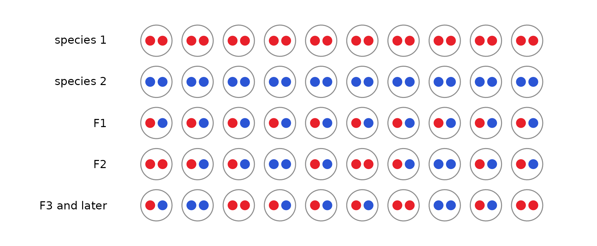

Across many markers, an individual’s *S* and *H* are averages of these
one-marker pictures. What changes with age is subtler: how genotypes are
arranged along chromosomes, how unevenly ancestry is spread across
markers, and how often individuals look like recent crosses. The
processes below change those same patterns.

## Linkage

Markers on the same chromosome are inherited together until
recombination separates them. In the first hybrid generations the blocks
of each species’ ancestry are long; every generation of recombination
cuts them shorter. Below, five individuals from the second hybrid
generation (top) and the eighth (bottom) of the same closed population
are painted along three chromosomes: red where both copies come from
species 1, blue where both come from species 2, and purple where the
individual is heterozygous. Asterisks mark a typical panel of 30
markers.

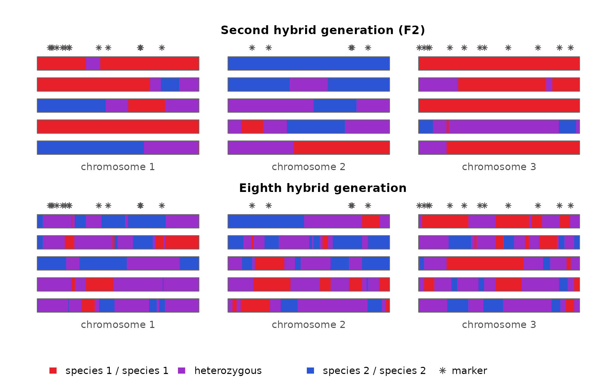

Within one individual, markers that sit in the same long block all
report the same ancestry, so they repeat one piece of information rather
than adding new ones. An individual’s *S* and *H* are averages over its
markers, and with long blocks those averages rest on only a few
independent pieces. Averages of a few pieces vary more than averages of
many, so F2s typed at linked markers differ from one another much more
than F2s typed at unlinked markers: one may happen to carry mostly
species-2 blocks, another mostly species-1 blocks. The triangle shows F2
families typed at 30 markers, either unlinked or on three short
chromosomes.

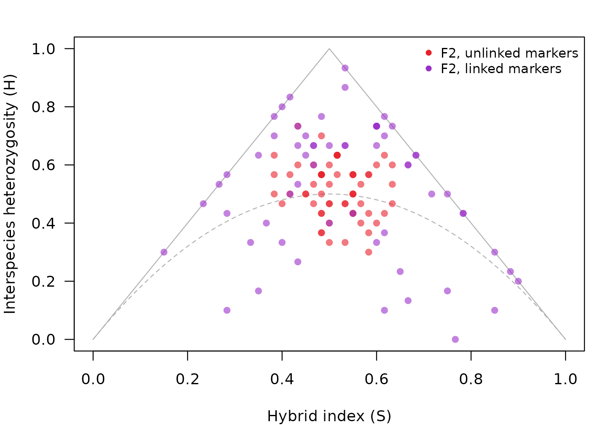

A spread like this is not what a single F2 family looks like when
markers are assumed to be independent. It looks like a mix of hybrid
classes: some individuals near the F1 corner, others near the
backcrosses or below the dashed curve, where later generations fall.
Classified one at a time on the assumption that markers are independent,
only about 40% of these F2s are called F2, and a fifth are called
later-generation hybrids:

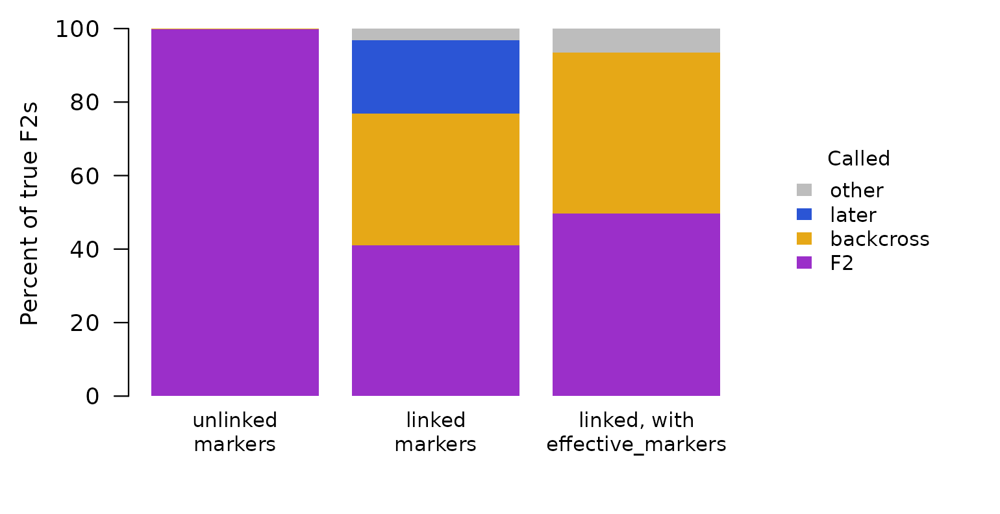

So an F2 family typed at linked markers can be read as a more mixed,
more advanced population than it is.

**How hybridclock handles it.** The simulated reference includes
linkage: either the real genetic map (`map`, with `map_scale` for
uncertainty in its length) or a range of chromosome numbers and map
lengths, so clustered markers in the data are compared with simulations
that cluster the same way. For individual classes,
[`effective_markers()`](https://paulmaier.github.io/hybridclock/reference/effective_markers.md)
tells the classifier how many independent markers a linked panel is
worth, which removes the false “later” calls (right-hand bar above);
with so few independent markers, the remaining classes stay uncertain,
which is why the population clock relies on simulations that include
linkage. With a map, the clock also counts how often an individual’s
genotype switches between neighboring markers. Those switches mark the
boundaries between ancestry blocks, and they become more common with
every generation:

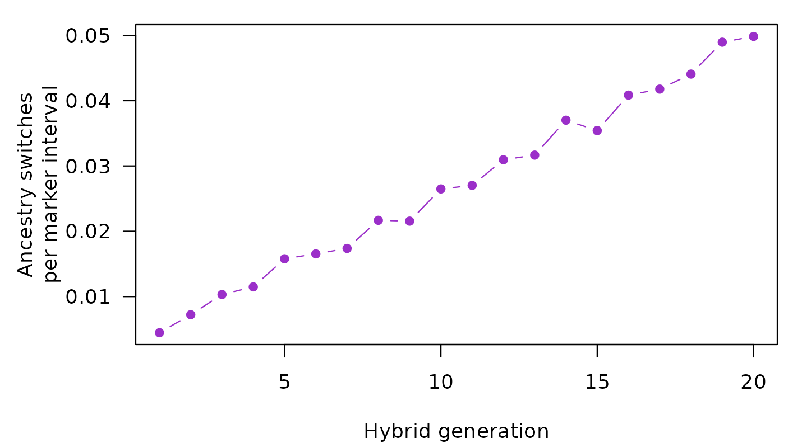

## Inbreeding

Inbreeding (mating between relatives, for example in small breeding
groups) removes heterozygotes. Below, the top two rows show a diagnostic
marker in a young, inbred population and in an older population that
mates at random: both have fewer heterozygotes than an F2. The bottom
two rows show a marker that is polymorphic within both species (gold and
grey alleles, with nothing to do with hybrid ancestry). There the two
populations differ: only the inbred one is missing heterozygotes.

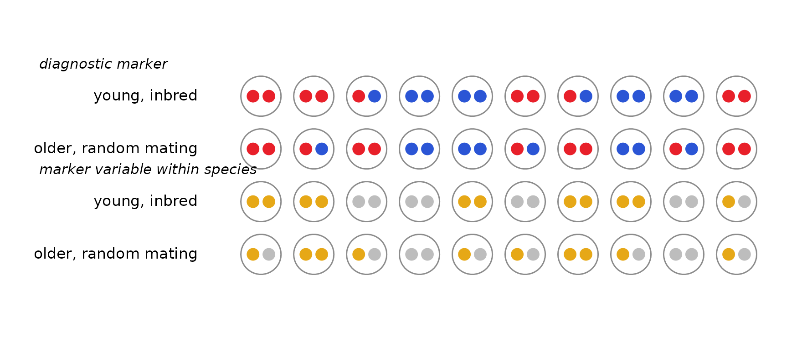

Lower heterozygosity at diagnostic markers is a sign of age, so
inbreeding alone can make a young population look old. The simulations
below compare populations at the fifth hybrid generation, bred in three
small groups with frequent sibling mating, against populations of 60
breeders that have mated at random for thirty generations. At the
diagnostic markers they look alike: both have about 20% fewer
heterozygotes than random mating at their ancestry would give (left).
Only the inbred populations are also missing heterozygotes at markers
that vary within species (right, the inbreeding coefficient at those
markers).

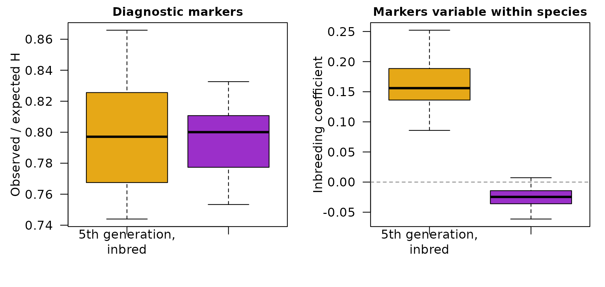

**How hybridclock handles it.** Markers that vary within both species
([`shared_loci()`](https://paulmaier.github.io/hybridclock/reference/shared_loci.md))
give a separate measure of inbreeding and linkage disequilibrium, and
the simulated reference includes sibling mating and separate breeding
pools (`sib_mating`, `pools`). The clock learns to read age from the
diagnostic markers while accounting for inbreeding measured at the
shared ones.

## Drift

Each generation, a breeding population passes on a random sample of its
alleles, like drawing beads from a jar. At each marker, the share of
species-2 ancestry wanders away from the population average, and the
smaller the population, the faster it wanders. Below, each jar is one
marker, and its 20 beads show the share of species-2 ancestry (blue) at
that marker in the population.

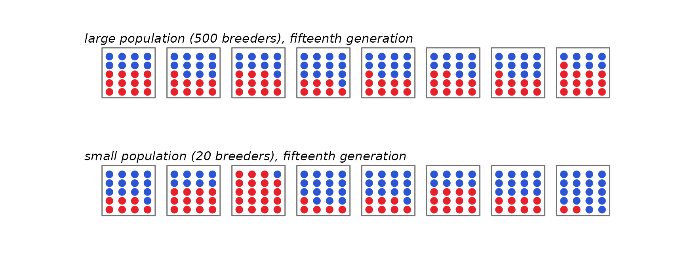

Drift acts on allele frequencies. In a population founded by F1s, every
diagnostic marker starts with half its alleles from each species. As the
share at each marker wanders, two things happen at once:

- **at each marker, the alleles become more alike.** As the share moves
  toward 0 or 1, more and more individuals carry the same species’
  allele there, so individuals also become more alike;
- **across markers, the shares become more different.** Some markers end
  up mostly species 1 and others mostly species 2, so ancestry becomes
  uneven along the genome.

These are the same process seen two ways. hybridclock measures the
second as the variance of the species-2 share across markers, divided by
its largest possible value. It runs from 0, when every marker has the
same share, to 1, when every marker is fixed for one species or the
other (like *F*_(ST), with markers in place of populations). On the left
below are the shares at all 400 markers in the two populations above; on
the right is the measure over 30 generations at three breeding sizes:

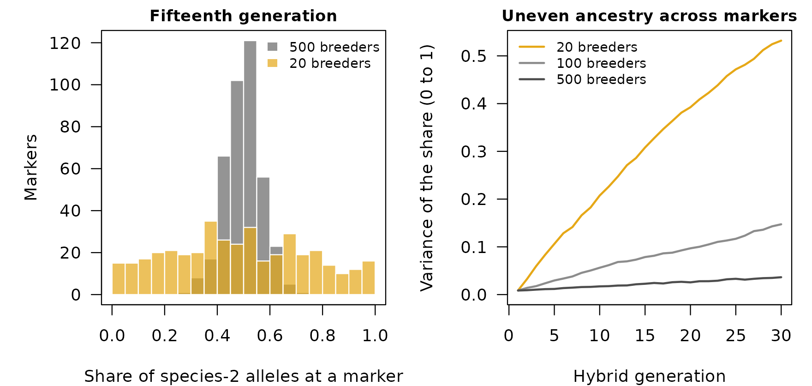

Ancestry becomes uneven with time, and in a closed population its pace
depends on the breeding size. A small population reaches in a few
generations the unevenness that a large one reaches only after many, so
time and breeding size trade off: a small population can look as old as
a much older large one.

Separate populations drift independently, so the same marker can end up
mostly species 1 in one population and mostly species 2 in another, and
the populations grow apart. hybridclock dates each population on its own
and does not use that divergence.

Drift is also tied to linkage and inbreeding. In a small population,
drift creates associations between markers even on different chromosomes
(linkage disequilibrium), and mating among relatives becomes
unavoidable, so drift, linkage disequilibrium and inbreeding grow
together. Linkage disequilibrium from drift pushes the same way as
linkage on a chromosome: markers that are inherited together make
individuals differ more. In the simulations, though, the alleles
becoming more alike at each marker outweigh it, and individuals still
become more alike as the population drifts. hybridclock measures linkage
disequilibrium and inbreeding at markers that vary within species, and
its simulations combine breeding size, mating among relatives and the
map, so the clock sees these processes together rather than one at a
time.

**How hybridclock handles it.** In a closed population, after the first
few generations drift is the main clock. The reference draws the
breeding size from a range (`breeders`), so the estimate allows for any
size in that range. Give the widest range that is plausible: a range
that misses the true size gives precise but wrong ages, while a generous
one only widens the interval.

## Heterozygote dropout

With low sequencing depth or allele-specific failure, one allele of a
heterozygote can go undetected, and the individual is called homozygous
(dashed dot below). Missing heterozygotes look like the loss of
heterozygosity that comes with age, so individuals slide down the
triangle.

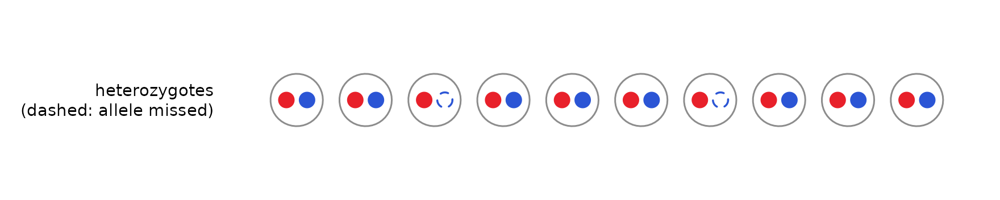

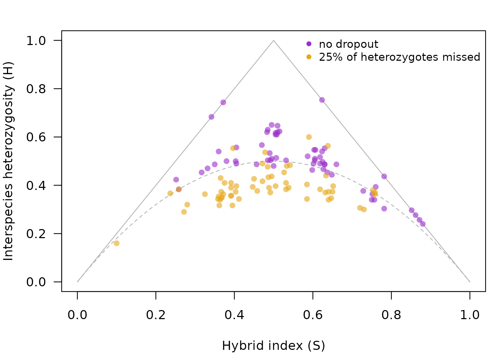

**How hybridclock handles it.** The reference simulates dropout over a
range (`het_dropout`), and the classifier behind the class shares is
told the dropout rate through `class_settings(het_dropout = ...)`, so
the simulated and the real samples are read the same way. The bettongs
in the [full
tutorial](https://paulmaier.github.io/hybridclock/articles/tutorial.md)
are an example.

## Continuing gene flow

When pure individuals of one species keep arriving, they mate with
hybrids and start new, short pedigree lines. Hybrid age then stops
growing and levels off, however long the species have been in contact:

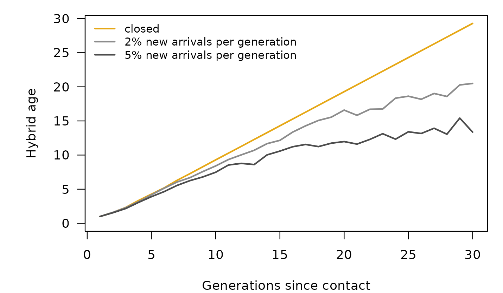

This is not an error: hybrid age measures the pedigrees of the hybrids,
not the time since contact. But it means that a young-looking population
may have been in contact for a long time.

**How hybridclock handles it.** The reference includes arrivals of
either species, at constant rates or rates that stop or start partway,
and the package also reports the hybrid age of the rarer species’ lines
and the probability that pure individuals are still arriving. With
continuing gene flow, hybrid age is a lower bound on the time since
contact.

## Selection

Selection against one species’ ancestry in parts of the genome removes
that ancestry from those regions faster than drift would. The painting
below illustrates this (it is a drawing, not a simulation): the same
individuals as in the linkage section, with species-2 ancestry purged
from most of chromosome 2.

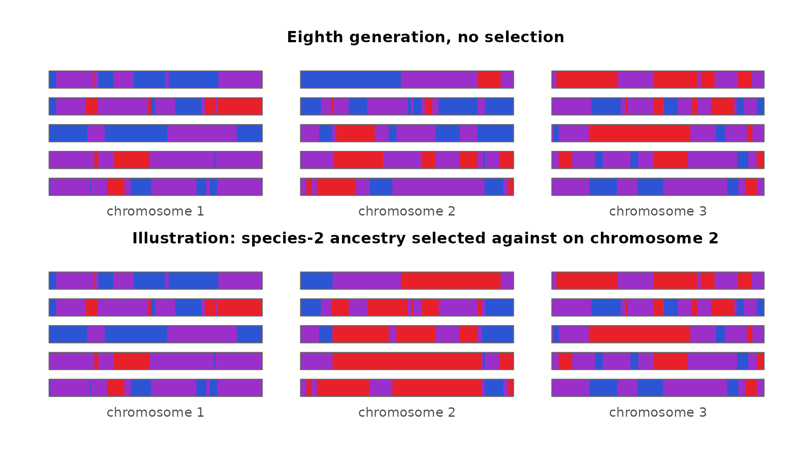

Regions under selection carry less heterozygosity and more uneven
ancestry than the rest of the genome, which is what drift and age
produce too. In experimental sunflower hybrids under strong selection,
estimates ran ahead of the true number of generations for several
generations.

**How hybridclock handles it.** It doesn’t: the simulations assume
neutral markers. Leaving out the most differentiated markers did not
help in the sunflowers, because the selected blocks covered several
whole chromosomes. Where strong selection is suspected, estimates may be
too old.

## Summary

| Process | How it can look like age | What hybridclock does |
|----|----|----|
| Linkage | linked markers make an F2 family look like a mix of hybrid classes | simulates the map, or a range of maps; [`effective_markers()`](https://paulmaier.github.io/hybridclock/reference/effective_markers.md) for classes; counts ancestry switches with a real map |
| Inbreeding | fewer heterozygotes at diagnostic markers | measures inbreeding at shared loci; simulates sibling mating and breeding pools |
| Drift | uneven ancestry across markers builds up faster in small populations | draws the breeding size from a range |
| Heterozygote dropout | missed heterozygotes lower *H* | simulates dropout; the classifier is told the rate |
| Continuing gene flow | hybrid age levels off | simulates arrivals; reports the rarer species’ age and the probability of arrivals |
| Selection | purged regions look like drift | not modeled: a stated limitation |

The settings for each are described in the [getting-started
vignette](https://paulmaier.github.io/hybridclock/articles/hybridclock.md),
and the [full
tutorial](https://paulmaier.github.io/hybridclock/articles/tutorial.md)
applies them to five real datasets.
