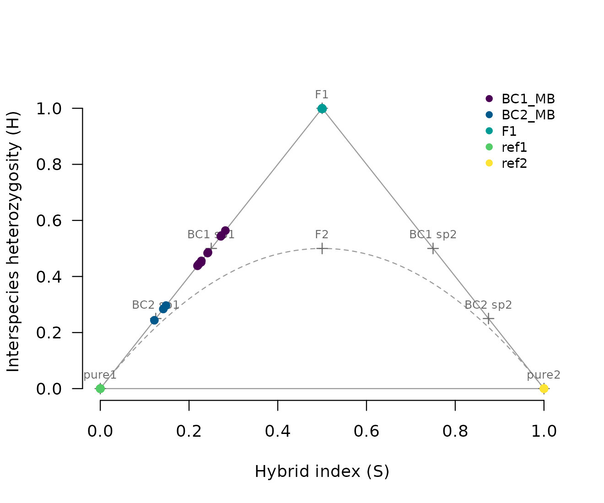

# Full tutorial: dating hybrid populations in five real datasets

This tutorial runs hybridclock on the five example datasets that come
with the package. Each one is a different situation that people studying
hybrids run into: a captive cross with a known pedigree, an advanced
intercross with a genetic map, a closed population founded once, a
genetic rescue typed at microsatellites, and an invasive hybrid zone
where only an upper bound on age is known. In every case the true age of
the hybrids is known or bounded, so you can see how close the estimates
come.

The settings follow the rules used to validate the package on 23 truth
sets (Maier, in preparation): describe what is known about the
population, and keep the ranges generous. To keep the run time down,
each reference here has 2,000 simulated histories. For real analyses use
6,000 or more. The whole tutorial takes about 15 minutes on four cores;
most of that is building the references.

``` r

library(hybridclock)
cores <- 4
```

## 1. Recent hybrids: Mexican wolves

The Mexican wolf (*Canis lupus baileyi*) was saved from extinction by
three captive lineages, which were kept apart for 15 to 20 years and
then crossed. The `wolves` data hold pure wolves of two lineages,
McBride (`ref1`) and Ghost Ranch (`ref2`), and the F1s, first
backcrosses and second backcrosses that followed, each with its class
from the studbook.

First, choose diagnostic markers from the two reference groups and score
every wolf. The hybrid index *S* is the share of alleles from species 2
(here Ghost Ranch), and the interspecies heterozygosity *H* is the share
of markers with one allele from each.

``` r

mk <- diagnostic_markers(wolves$genotypes, wolves$groups, "ref1", "ref2")
nrow(mk)
#> [1] 486
sc <- hybrid_scores(wolves$genotypes, mk)
plot_triangle(sc, wolves$groups)
```



The F1s sit at the top of the triangle (*S* = 0.5, *H* = 1), and each
backcross halves *H* and moves toward the McBride corner. With 486
markers, individual classes are easy:

``` r

cl <- classify_hybrids(sc)
table(studbook = wolves$animals$class, called = cl$class)
#>               called
#> studbook       BC1_species1 BC2_species1 F1 pure1 pure2
#>   BC1_species1           11            0  0     0     0
#>   BC2_species1            0            3  0     0     0
#>   F1                      0            0  5     0     0
#>   pure1                   0            0  0    31     0
#>   pure2                   0            0  0     0     6
```

Every wolf is placed in its studbook class. To date the hybrids as a
population, build a reference of simulated histories that matches the
data (the number of markers, the sample size, and a genetic map given as
a number of chromosomes and a range of total lengths), train the clock,
and estimate:

``` r

hyb <- !wolves$groups %in% c("ref1", "ref2")
ref <- build_reference(n_sims = 2000, generations = 20, n_markers = nrow(mk),
                       sample_size = sum(hyb), het_dropout = c(0, 0),
                       map = list(chromosomes = c(38, 38), length_cM = c(1800, 2400)),
                       cores = cores, seed = 1)
clock <- train_clock(ref, cores = cores)
diag <- orient_genotypes(wolves$genotypes, mk)
est <- estimate_history(clock, sc[hyb, ], rep("hybrids", sum(hyb)), diag = diag[hyb, ])
est[, c("population", "n_hybrids", "method", "hybrid_age_both",
        "hybrid_age_both_lower", "hybrid_age_both_upper", "information")]
#>   population n_hybrids             method hybrid_age_both hybrid_age_both_lower
#> 1    hybrids        19 individual classes        1.407895              1.273916
#>   hybrid_age_both_upper information
#> 1              1.555964    0.928429
mean(wolves$animals$hybrid_age[hyb])
#> [1] 1.407895
```

Every hybrid fits an early class, so the answer comes from the
individual classes (`method`), and it matches the true mean age from the
studbook.

## 2. An advanced intercross with a genetic map: chickens

The `chickens` data are generation F8 of an intercross between Red
Junglefowl and White Leghorn chickens, kept as a closed line of about
100 birds. Every bird is eight generations from the pure parents.
Individual classes cannot tell an F8 from an F2:

``` r

g <- chickens$genotypes
mkc <- data.frame(column = seq_len(ncol(g)), name = colnames(g), flip = FALSE,
                  freq1 = 0, freq2 = 1)
scc <- hybrid_scores(g, mkc)
table(classify_hybrids(scc)$class)
#> 
#> BC2_species1           F1           F2        later 
#>            1            1          417          153
```

The population clock can. Here the breeding design is documented, so the
reference uses it: F1 founders, a closed line with no sibling mating,
one breeding group and random mating. The genetic map is known, and with
a map the clock also uses ancestry switches between neighboring markers,
which multiply with every generation of recombination. A map is never
exact, so its length is stretched or shrunk by up to 25% in each history
(`map_scale`). Leaving that out makes the intervals too narrow.

``` r

pos <- chickens$map[, c("chromosome", "position")]
refc <- build_reference(n_sims = 2000, generations = 50, breeders = c(30, 150),
                        n_markers = nrow(mkc), sample_size = 20,
                        founders = "F1", kinds = c(closed = 1, one = 0, both = 0),
                        sib_mating = c(0, 0), pools = 1, assort = c(0, 0),
                        het_dropout = c(0, 0), map = pos, map_scale = c(0.75, 1.25),
                        cores = cores, seed = 2)
clockc <- train_clock(refc, cores = cores)
#> Warning: Skipping targets that do not vary in the reference: backcrosses,
#> arriving, arrival_rate
estc <- estimate_history(clockc, scc, chickens$groups, diag = g, positions = pos,
                         repeats = 20)
estc[, c("population", "n", "method", "hybrid_age_both",
         "hybrid_age_both_lower", "hybrid_age_both_upper")]
#>   population   n           method hybrid_age_both hybrid_age_both_lower
#> 1         F8 572 population clock        8.711943                7.1117
#>   hybrid_age_both_upper
#> 1              11.00027
```

The true age is 8. The warning says that every simulated history here
has no backcrosses and no arrivals, so those quantities are not
estimated. A known map roughly halves the width of the intervals
compared with a map given only as a range of lengths.

## 3. A single founding of a closed population: burrowing bettongs

Burrowing bettongs (*Bettongia lesueur*) from two subspecies were
released together into a fenced reserve in 2010 and sampled every year
until 2018. No new animals arrived, so the population is closed.
Bettongs can breed in their first year, so the hybrids sampled *k* years
after the release can be at most *k* generations old.

These genotypes have heterozygote dropout: about a quarter of
heterozygotes are called homozygous. The classifier needs to know this,
and the settings given to
[`class_settings()`](https://paulmaier.github.io/hybridclock/reference/class_settings.md)
are stored with the reference, so the simulated and the real samples are
classified the same way.

``` r

mkb <- diagnostic_markers(bettongs$genotypes, bettongs$groups, "ref1", "ref2")
scb <- hybrid_scores(bettongs$genotypes, mkb)
diagb <- orient_genotypes(bettongs$genotypes, mkb)
years <- bettongs$truth$group[bettongs$truth$n >= 15 & !is.na(bettongs$truth$year)]
keep <- bettongs$groups %in% years
refb <- build_reference(n_sims = 2000, generations = 10, n_markers = nrow(mkb),
                        sample_size = 15, kinds = c(closed = 1, one = 0, both = 0),
                        het_dropout = c(0.15, 0.35),
                        map = list(chromosomes = c(10, 12), length_cM = c(800, 2000)),
                        missing = rowMeans(is.na(diagb[keep, ])),
                        class_settings = class_settings(het_dropout = 0.25),
                        cores = cores, seed = 3)
clockb <- train_clock(refb, cores = cores)
#> Warning: Skipping targets that do not vary in the reference: arriving,
#> arrival_rate
estb <- estimate_history(clockb, scb[keep, ], bettongs$groups[keep], diag = diagb[keep, ])
data.frame(estb[, c("population", "n_hybrids", "method", "hybrid_age_both",
                    "hybrid_age_both_lower", "hybrid_age_both_upper")],
           bound = bettongs$truth$max_hybrid_age[match(estb$population, bettongs$truth$group)])
#>   population n_hybrids           method hybrid_age_both hybrid_age_both_lower
#> 1 Matuwa2011         3 population clock        2.156335              1.836367
#> 2 Matuwa2012        11 population clock        1.740677              1.492469
#> 3 Matuwa2013        21 population clock        2.477023              2.061469
#> 4 Matuwa2014        26 population clock        2.429422              2.016287
#> 5 Matuwa2015        14 population clock        2.301644              1.946361
#> 6 Matuwa2016        13 population clock        2.315019              1.953570
#> 7 Matuwa2017        11 population clock        1.713860              1.462589
#> 8 Matuwa2018        13 population clock        2.072783              1.742799
#>   hybrid_age_both_upper bound
#> 1              2.522801     1
#> 2              2.023058     2
#> 3              2.963914     3
#> 4              2.914798     4
#> 5              2.711397     5
#> 6              2.732750     6
#> 7              2.001055     7
#> 8              2.455523     8
```

From 2012 on, hybrid age stays at about two generations while the time
since the release grows, which fits a generation time of about three
years: the reserve had seen fewer than three generations by 2018
(`bettongs$truth$generations_at_3yr`). The 2011 sample has only three
hybrids, and its estimate is above the bound of one generation. A
population estimate from so few hybrids should not be trusted.

## 4. Microsatellites: a genetic rescue of mountain pygmy possums

The mountain pygmy possum (*Burramys parvus*) population at Mount Buller
was rescued in 2011 by releasing six males from Mount Higginbotham. The
`possums` data hold 24 microsatellites. Microsatellites rarely have
alleles fixed between species, so *S* and *H* are estimated by
likelihood from the reference allele frequencies, and the reference
simulates alleles drawn from those frequencies.

``` r

ms <- microsat_markers(possums$alleles, possums$groups, "ref1", "ref2")
scp <- hybrid_scores_microsat(possums$alleles, ms)
yrs <- c("Buller2012", "Buller2013", "Buller2014", "Buller2015")
keep <- possums$groups %in% yrs
refp <- build_reference(n_sims = 2000, generations = 10, sample_size = 20,
                        microsat = ms, het_dropout = c(0, 0), cores = cores, seed = 4)
clockp <- train_clock(refp, cores = cores)
estp <- estimate_history(clockp, scp[keep, ], possums$groups[keep])
estp[, c("population", "n_hybrids", "method", "hybrid_age_both",
         "hybrid_age_both_lower", "hybrid_age_both_upper")]
#>   population n_hybrids           method hybrid_age_both hybrid_age_both_lower
#> 1 Buller2012        13 population clock        1.068599              1.000000
#> 2 Buller2013        32 population clock        1.416803              1.200029
#> 3 Buller2014        69 population clock        1.877041              1.407572
#> 4 Buller2015       110 population clock        2.564040              1.783608
#>   hybrid_age_both_upper
#> 1              1.181727
#> 2              1.722884
#> 3              2.634588
#> 4              3.918200
possums$truth[possums$truth$group %in% yrs, c("group", "hybrid_age")]
#>        group hybrid_age
#> 4 Buller2012        1.0
#> 5 Buller2013        1.5
#> 6 Buller2014         NA
#> 7 Buller2015         NA
```

The 2012 hybrids are all F1s (age 1), and those of 2013 are F1s, F2s and
backcrosses (about 1.5). In 2014 and 2015 only upper bounds are known: 3
and 4 generations.

## 5. An invasive hybrid zone with generic settings: Asian carp

Bighead and silver carp were imported from China in 1973, were in the
open waters of the Mississippi River basin by the early 1980s, and have
hybridized there since. The `carp` data hold three river sites sampled
in 2009 to 2011. Only an upper bound on hybrid age is known: about 12
generations, from the time since the imports and a generation time of at
least three years. Little is known about the breeding population, so the
reference uses the package defaults: up to 50 generations, 10 to 500
breeders, any founding share, and arrivals of either species allowed.
The map is given as the carp karyotype (24 chromosomes) and a broad
range of lengths.

``` r

mkk <- diagnostic_markers(carp$genotypes, carp$groups, "ref1", "ref2")
sck <- hybrid_scores(carp$genotypes, mkk)
diagk <- orient_genotypes(carp$genotypes, mkk)
sites <- c("IMAR", "PL26", "MKY")
keep <- carp$groups %in% sites
refk <- build_reference(n_sims = 2000, n_markers = nrow(mkk), sample_size = 20,
                        het_dropout = c(0, 0),
                        map = list(chromosomes = c(24, 24), length_cM = c(1500, 3500)),
                        cores = cores, seed = 5)
clockk <- train_clock(refk, cores = cores)
estk <- estimate_history(clockk, sck[keep, ], carp$groups[keep], diag = diagk[keep, ],
                         repeats = 20)
estk[, c("population", "n_hybrids", "method", "hybrid_age_both",
         "hybrid_age_both_lower", "hybrid_age_both_upper", "arriving", "information")]
#>   population n_hybrids           method hybrid_age_both hybrid_age_both_lower
#> 1       IMAR       206 population clock        3.134852              1.834490
#> 2        MKY        37 population clock        6.526956              2.536263
#> 3       PL26        75 population clock        3.379175              1.771063
#>   hybrid_age_both_upper  arriving information
#> 1              5.695512 0.6617952   0.6257939
#> 2             18.714472 0.3418712   0.3398514
#> 3              6.941874 0.5541791   0.5488066
```

All three sites are below the bound of 12 generations. The lower
Mississippi site (`MKY`) has the fewest hybrids and the widest interval,
and its lower `information` value says that much of its answer reflects
the reference’s range. The probability that pure fish are still arriving
is between about one third and two thirds; F1s born as late as 2006 show
that hybridization was still going on.

## Reading the answer

Each row of
[`estimate_history()`](https://paulmaier.github.io/hybridclock/reference/estimate_history.md)
is one population. The columns to read first are:

- `method`: `"individual classes"` when the answer comes from the
  classes (samples made up of F1s and backcrosses, where the reference
  shows the classes to be more accurate), `"population clock"`
  otherwise.
- `hybrid_age_both` with `_lower` and `_upper`: the hybrid age and its
  90% interval. Hybrid age is the number of generations back to the
  nearest pure ancestor, averaged over the lines of each hybrid’s
  pedigree and then over the hybrids.
- `hybrid_age_rare` and `backcrosses`: how long ago the rarer species’
  genes entered, and how many matings with pure animals there have been
  since the first cross.
- `arriving`: the probability that pure animals of the rarer species are
  still arriving. When they are, hybrid age levels off, and it is then a
  lower bound on the time since contact.
- `information`: near 1 when the interval is much narrower than the
  range of the reference, near 0 when the answer mostly reflects the
  settings. Low values usually mean few or weak markers.

## Using your own data

The same steps apply to any pair of species or lineages:

1.  Choose diagnostic markers with
    [`diagnostic_markers()`](https://paulmaier.github.io/hybridclock/reference/diagnostic_markers.md)
    from pure reference samples, or
    [`microsat_markers()`](https://paulmaier.github.io/hybridclock/reference/microsat_markers.md)
    for microsatellites. For SNPs that are not fixed, give the reference
    allele frequencies to
    [`build_reference()`](https://paulmaier.github.io/hybridclock/reference/build_reference.md)
    (`freq`); see the vignette.
2.  Check that the markers are diagnostic in the animals that actually
    bred, with
    [`check_markers()`](https://paulmaier.github.io/hybridclock/reference/check_markers.md),
    if your sample has F1s.
3.  Build a reference that describes what you know, with generous
    ranges: the founders (`founders`), whether the population is closed
    (`kinds`), a ceiling on the number of generations from the earliest
    possible date of contact (`generations`), the breeding size
    (`breeders`), and the map.
4.  Train the clock and estimate, and read the `information` column.

[`markers_needed()`](https://paulmaier.github.io/hybridclock/reference/marker_power.md)
helps plan a study: dating F2 families within half a generation took
about 50 diagnostic markers in simulations, and older populations need
more.

## Citation

If you use hybridclock, please cite both:

- Maier PA, Mabe JA, Hale JL, Herman AE, Kantz BP (2024) Hybridization
  between *Anaxyrus boreas* × *canorus* within Eldorado National Forest:
  the first genomic assessment. Final report to the US Forest Service.
- Maier PA (2026) hybridclock: Dating hybrid populations beyond F2, with
  or without a genetic map. Manuscript in preparation.

Run `citation("hybridclock")` for the entries.

The example data come from Fitak et al. (2018, *Journal of Heredity*),
Johnsson et al. (2016, *Genetics*), Rick et al. (2019, *Genes*), Weeks
et al. (2017, *Nature Communications*) and Lamer et al. (2015,
*Molecular Ecology*); see the help page of each dataset for the full
references and licences.
